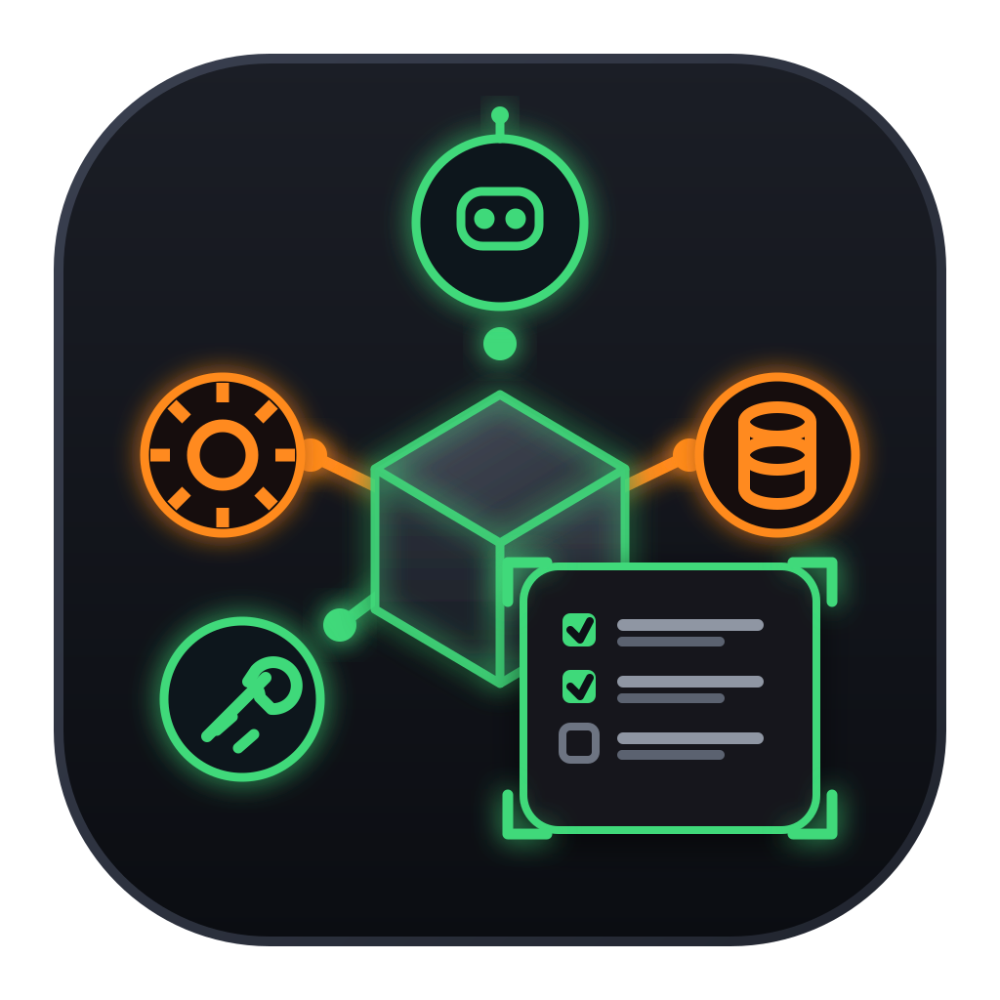

# LLM Tester

A local-first workbench for inspecting, comparing and auditing language models. Every request passes
through your own machine, so the exact request body, the masked headers and the raw upstream response
stay readable.



## What it does

| Workspace | Purpose |
|---|---|
| **Chat** | Stream a request and read the response, reasoning trace and developer evidence. |
| **Models** | Live model discovery, capability columns, and an inspector that shows a Modelfile or the provider catalogue entry. |
| **Ollama** | Version, installed and running models, pull, delete, stop, reload, and tuning of the local server's environment. |
| **Compare** | Run two models over the same saved cases, review the responses blind against a rubric, then record a pair preference and a replacement verdict. |
| **Skills** | Import a skill file, read its steps in plain English, view its flow, edit the source, and run the same skill across chosen remote models. |
| **MCP** | Register remote MCP servers, complete OAuth with dynamic client registration and PKCE, list tools, call them, and read a measured audit log. |
| **Audit** | Run list and evidence from saved comparisons. |
| **Settings** | Provider CRUD, remote HTTP toggle, and where data lives. |

## Requirements

- macOS, Node 20 or newer.
- For the Ollama workspace only: a local [Ollama](https://ollama.com) install.

## Getting started

```bash
npm start          # builds the client, then serves http://127.0.0.1:8787
```

Open `http://127.0.0.1:8787` and add a provider in **Settings**. Keys are written to
`~/Library/Application Support/LLM Tester/state.json` at mode `0600`.

Other scripts:

```bash
npm run dev             # Vite dev server on 5173, proxying /api to 8787
npm run build           # build the client only
npm run build:watch     # rebuild the client on change
npm test                # Node test suite
```

## Providers

Presets cover Ollama (local), Ollama Cloud, 9Router, Poolside, OpenRouter, OpenCode Zen, OpenCode Go,
ClinePass and a custom OpenAI-compatible endpoint. A provider needs a base URL and, where the service
requires it, a bearer token.

Remote HTTP is off by default. Plain `http://` is accepted only for loopback hosts until you enable it
explicitly in **Settings**.

## Standalone macOS build

```bash
node scripts/build-app.mjs
```

This produces `build/LLM Tester.app` and `build/LLM Tester.dmg`. The bundle carries its own server, built
as a Node single-executable binary (`scripts/build-sea.mjs`), plus the client build. A small launcher
starts that server on `127.0.0.1:8787`, waits for it, then opens the window. Launching the app does not
require `npm start` or a terminal.

The build is ad-hoc signed. Distributing it to another Mac needs a Developer ID and notarisation, which
are out of scope here.

## How it works

```text
client/  React + Vite UI, served from client/dist
server.mjs  HTTP server: static assets, same-origin checks, provider proxy, Ollama control
lib/state.mjs         provider registry and persisted settings
lib/llm/              parameter registry, wire mapping, Modelfile and catalogue inspection
lib/comparison/       case storage, paired runner, rubric evaluation, report building
lib/skills/           skill parsing, storage, explanation and cross-model runs
lib/mcp/              JSON-RPC transport, OAuth, registry, audit log
```

The server binds `127.0.0.1` only, requires a per-process session token on mutating requests, and
serves a self-only Content Security Policy. There are no analytics, no telemetry and no relay: outbound
traffic goes only to the provider you configure.

### Data on disk

| What | Where |
|---|---|
| Provider keys, settings, MCP servers | `~/Library/Application Support/LLM Tester/state.json` (0600) |
| Comparison runs and saved cases | `.../LLM Tester/comparisons/` |
| Imported skills | `.../LLM Tester/skills/` |
| MCP audit log | `.../LLM Tester/mcp-audit.json` (0600) |

Delete that folder to reset the app.

## Security notes

- Keys never leave the machine except as an `Authorization` header to the provider you selected, and
  they are masked in any request trace the UI shows.
- The MCP audit log stores tool arguments verbatim. Do not pass secrets as tool arguments.
- Blind comparison review hides model identity, timing and provider errors until every response in the
  batch has been reviewed against its rubric.

## Tests

```bash
npm test
```

Covers the request proxy, provider discovery, comparison contract and runner, rubric evaluation, case
storage, skill parsing and runs, MCP transport, OAuth and routes, and the blind-review rules.

## Licence

MIT. See [LICENSE](LICENSE).
